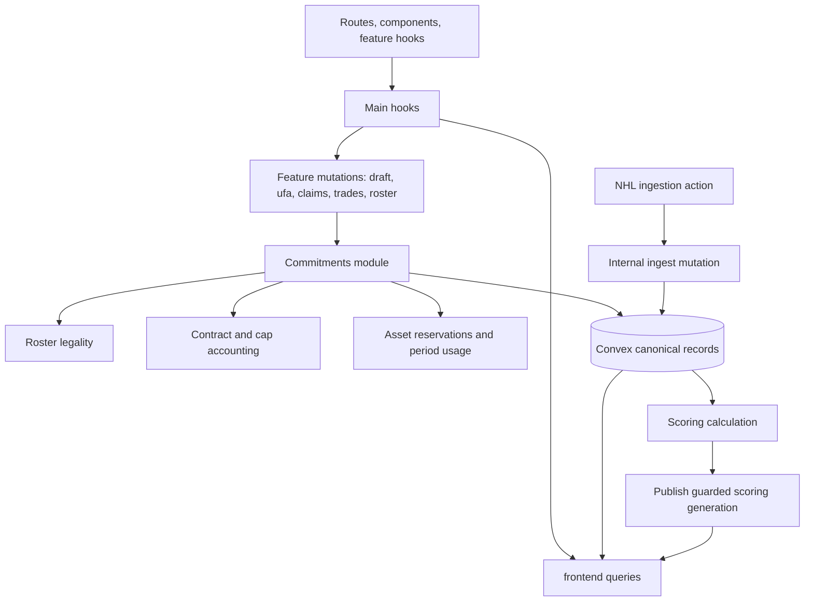
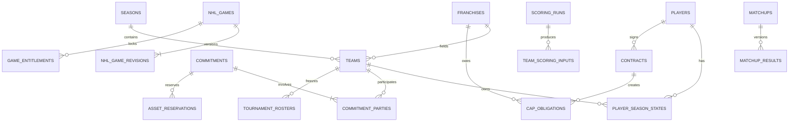
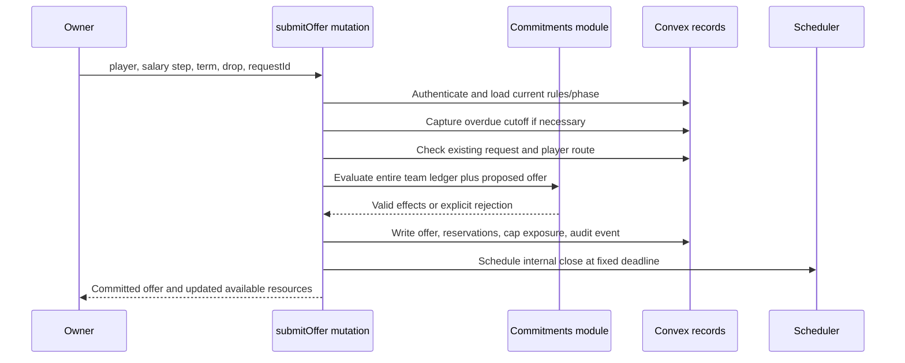
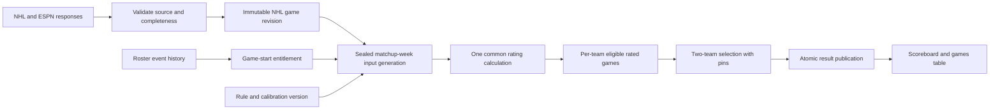
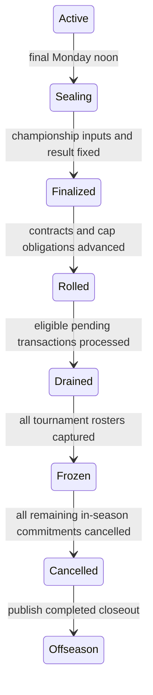

# GSHL relaunch: Convex data and function design

**Architecture proposal · October 17, 2026 · No schema migration or deployment performed**

[Complete system guide](gshl-relaunch-system-guide.md) ·
[Owner proposal](gshl-relaunch-owner-proposal.md) ·
[Acceptance model](gshl-relaunch-acceptance.md)

This is the recommended implementation structure for the agreed rules. Table
and function names marked **new** are proposed, not existing exports. Existing
names refer to the repository inspected for this report. The objective is a
small number of shared rule modules, bounded reads, short atomic transactions,
and published scoring snapshots that the browser can consume cheaply. It is a
design recommendation, not a measured claim of optimal production performance.

## Contents

1. [Design priorities](#1-design-priorities)
2. [What exists and what changes](#2-what-exists-and-what-changes)
3. [The module structure](#3-the-module-structure)
4. [Data conventions and invariants](#4-data-conventions-and-invariants)
5. [Tables and indexes](#5-tables-and-indexes)
6. [Efficient commitment validation](#6-efficient-commitment-validation)
7. [Public and internal function interfaces](#7-public-and-internal-function-interfaces)
8. [Transaction and market execution](#8-transaction-and-market-execution)
9. [Scoring and ingestion](#9-scoring-and-ingestion)
10. [Clocks, queues, and season closeout](#10-clocks-queues-and-season-closeout)
11. [Read models and subscriptions](#11-read-models-and-subscriptions)
12. [Authorization, audit, and recovery](#12-authorization-audit-and-recovery)
13. [Scale and performance budgets](#13-scale-and-performance-budgets)
14. [Migration and rollout](#14-migration-and-rollout)
15. [Implementation acceptance](#15-implementation-acceptance)

## 1. Design priorities

The most important optimization is to avoid recomputing the league's history
whenever one owner opens a screen or submits an offer. A team has at most 23
current roster players, a market has at most 14 franchise bidders, and a normal
week has seven head-to-head matchups. Use these natural scopes.

| Priority              | Recommendation                                                                | Why it matters                                                                |
| --------------------- | ----------------------------------------------------------------------------- | ----------------------------------------------------------------------------- |
| Correct commitments   | One module validates every cap, roster, asset, and move reservation           | A trade and a UFA bid cannot spend the same room through different validators |
| Small atomic writes   | One mutation per submitted command, award, or executed exchange               | Partial ownership transfers and partial buyouts cannot become visible         |
| Shared computation    | Rate the common NHL pool once per scoring generation                          | Seven matchups should not repeat identical rating work                        |
| Cheap reads           | Subscribe to one team, market, or matchup projection                          | Background stat changes should not invalidate every screen                    |
| Reproducibility       | Versioned rules, source revisions, closing snapshots, and stored draw results | A result can be explained without rerunning today's changing data             |
| Incremental migration | Extend identity and established feature modules                               | Avoid a second league database and competing writers                          |

Convex mutations provide atomic, serializable database transactions with
optimistic conflict handling. The proposal relies on that transaction model;
it does not add a separate distributed lock manager.
[Convex OCC and atomicity](https://docs.convex.dev/database/advanced/occ)

Queries should select bounded indexed ranges. Index field order follows the
equality prefix, then a range/sort field. An index lookup is not a declaration of
uniqueness: the mutation must check the indexed identity before insertion.
[Convex indexes](https://docs.convex.dev/database/reading-data/indexes/)

## 2. What exists and what changes

The current application is already Next.js plus Convex. Keep the established
flow: routes → components → feature hooks → main hooks → Convex. Components
should not acquire direct database or navigation responsibilities during relaunch.

| Existing source                                                                   | Current responsibility                                                      | Relaunch treatment                                                                     |
| --------------------------------------------------------------------------------- | --------------------------------------------------------------------------- | -------------------------------------------------------------------------------------- |
| [`schema.ts`](../../convex/schema.ts)                                             | Canonical stored data, including legacy-compatible fields                   | Add strict new records and explicit version/phase references                           |
| [`frontend.ts`](../../convex/frontend.ts)                                         | Main browser facade                                                         | Return small purpose-built relaunch views                                              |
| [`draft.ts`](../../convex/draft.ts)                                               | Draft mutations and queries                                                 | Reuse entry point; replace clock/capacity rules behind its interface                   |
| [`ufa.ts`](../../convex/ufa.ts), [`ufaOdds.ts`](../../convex/ufaOdds.ts)          | Offers, resolution, current scoring inputs                                  | Retain market identity; integrate new commitments, typed snapshots, and weights        |
| [`contractSigningTransaction.ts`](../../convex/lib/contractSigningTransaction.ts) | Writes contract, player ownership, and signing picks inside caller mutation | Refactor into shared contract/roster/draft helpers; preserve one atomic caller         |
| [`teamLineup.ts`](../../convex/lib/teamLineup.ts)                                 | Current automatic lineup arrangement                                        | Replace relaunch path with legal main/reserve assignment; preserve historical behavior |
| [`timestamps.ts`](../../convex/lib/timestamps.ts)                                 | Timestamp normalization                                                     | Keep UTC instants and date-key conversion centralized                                  |
| [`crons.ts`](../../convex/crons.ts)                                               | Due work, UFA reconciliation, notifications, editorial work                 | Keep reconciliation scans; add durable exact-deadline scheduling                       |
| `notificationEvents`, `notifications`                                             | Event deduplication and owner delivery                                      | Reuse as the transaction's notification outbox                                         |
| `jobRuns`, `jobEvents`, `jobArtifacts`                                            | Operational progress and evidence                                           | Reuse for ingestion, scoring, migration, and reconciliation                            |
| Ranking sources in `scripts/src/runtime/`                                         | Authoritative numerical implementations                                     | Preserve source ownership; expose runtime-pure calculation adapters                    |

Today, `players` contains `ownerId`, `gshlTeamId`, and `lineupPos`; there is no
independent relaunch ownership/rights record. `playerDayStatLines` requires a GSHL
team and mixes day statistics with lineup information, so it cannot be the sole
canonical source for all NHL games, including unowned players. `contracts`
uses owner and signing-season fields with legacy-compatible salary values.

Existing UFA groups already have a player/season index and a status/deadline
index. Existing offers have group and owner/status indexes, but snapshot payloads
are serialized strings. Extend those concepts instead of creating another UFA
market system. Existing scoring and odds must remain on their current rules until
the appropriate season/feature version is activated.

The current signing helper also assigns picks across covered seasons. Do not
reuse that behavior blindly: the new keeper policy consumes latest available
original picks and preserves acquired picks according to roster capacity.

## 3. The module structure

Use deep modules with small interfaces. An endpoint asks to submit a commitment
or calculate a matchup; it should not orchestrate ten independent validation
helpers in the browser. Private helpers can be numerous without expanding the
interface callers must understand.



| Module         | Small interface                                    | Implementation it owns                                                  |
| -------------- | -------------------------------------------------- | ----------------------------------------------------------------------- |
| Rules/calendar | `resolveRules`, `resolvePeriod`, `nextEligibleRun` | Phase-specific caps, time zone, cutoffs, long matchups                  |
| Commitments    | `preview`, `submit`, `revise`, `settle`, `execute` | Resource validation, reservation writes, release, idempotency           |
| Rosters        | `evaluateArrangement`, `applyRosterEffect`         | Multi-position matching, tiers, ownership events, game-lock attribution |
| Contracts      | `quote`, `buildObligations`, `rollover`            | Covered seasons, signed salary, retention, buyout, contract cycle       |
| Markets        | `scoreSnapshot`, `award`                           | Claim/UFA factor rules, frozen inputs, one persisted draw               |
| Draft          | `submitPick`, `advanceClock`, `restorePicks`       | Active-hour clock, original/acquired picks, skips, fill picks           |
| Scoring        | `ratePool`, `selectMatchup`, `finalize`            | Rating cohorts, pins, goalie combinations, immutable final result       |

Convex adapters load records and commit effects. Pure calculation implementations
take explicit snapshots and return effects/results. Tests and public endpoints
cross the same interfaces. Keep deterministic app utilities under `src/lib/utils`;
keep authoritative ranking sources in their existing runtime location. Do not
put runtime exports in `src/lib/types`.

## 4. Data conventions and invariants

### Common types

| Data                  | Representation                                                          |
| --------------------- | ----------------------------------------------------------------------- |
| Internal references   | `Id<"table">`; Convex `_id` is canonical                                |
| Import compatibility  | Optional `legacyId`; never the new foreign-key convention               |
| Instants              | UTC epoch milliseconds                                                  |
| NHL day keys          | `YYYY-MM-DD` through the timestamp helpers                              |
| Display/calendar zone | `America/Toronto`, explicitly resolved for each scheduled instant       |
| Money                 | Integer cents; new salaries multiples of 5,000,000 cents                |
| Retention             | Integer basis points restricted to 1,000–5,000 in 1,000 steps           |
| Stats                 | Numeric counts, goalie seconds, explicit missing-data state             |
| Phase                 | Tagged union, not free-form strings                                     |
| Snapshots             | Typed objects plus version/hash; large artifacts use storage references |
| Request identity      | Authenticated actor + client request ID + payload hash                  |

Use integer arithmetic for $50K half-up rounding. Preserve exact retained shares
and buyout allocations in cents; validate imported amounts rather than repeatedly
coercing strings. A new contract's salary is different from its owner's net cap
share. NHL contract records are also distinct from GSHL contracts.

### Invariants every writer must preserve

1. One franchise owns a player's current season entitlement; UFA and drafting
   cannot award the same player independently.
2. A roster state is main, reserve, rights-only, or unowned. Tournament entitlement
   is a separate immutable snapshot, not another current ownership claim.
3. Every binding action is affordable and positionally legal for every relevant
   outcome and every affected season.
4. One asset cannot support two active exclusive reservations.
5. A game uses ownership and tier at game start, not whatever the current roster
   happens to be when the statistics arrive.
6. Each matchup reads one published scoring generation. Both opponents' selection
   comes from the same inputs and fixed category order.
7. After finalization, new data cannot revise that matchup's result.
8. A market award, transaction execution, and closeout phase each have durable
   idempotency identities; retries do not duplicate effects.

## 5. Tables and indexes

The tables below separate data with different lifetimes and query patterns.
They are not an instruction to store every displayed field twice. A projection
is explicitly derived and has one owning writer.

### 5.1 Identity, calendar, rules, and player state

| Table                                      | Status / cardinality                                   | Important fields                                                                                                                       | Required access paths                                                                                                    |
| ------------------------------------------ | ------------------------------------------------------ | -------------------------------------------------------------------------------------------------------------------------------------- | ------------------------------------------------------------------------------------------------------------------------ |
| `owners`, `franchises`, `teams`, `players` | Existing identities                                    | Keep current IDs; add team roster/commitment revisions                                                                                 | Existing identity indexes; team by season + franchise                                                                    |
| `seasons`, `weeks`, `matchups`             | Existing calendar                                      | Rule version; playing/offseason season references; management start/end; scoring finalization; result status                           | Season + start; week + matchup; team + season                                                                            |
| `leagueRuleVersions`                       | New; immutable per adopted version                     | Roster limits, category set, algorithms, cap phases, salary curve, buyout/retention rules, artifact hashes                             | `by_versionKey(versionKey)`                                                                                              |
| `seasonRuntime`                            | New; one per operating season                          | `phase`, `ruleVersionId`, `nextCutoffAt`, `activePeriodId`, `closeoutRunId`, calendar revision                                         | `by_season(seasonId)`                                                                                                    |
| `playerSeasonStates`                       | New; one per player/playing season                     | Player, franchise/team or null; mode; locked positions; contract cycle; market route; protected class; release eligible time; revision | `by_season_player(seasonId, playerId)`; `by_team_mode(teamId, mode)`; `by_season_route_rank(seasonId, route, draftRank)` |
| `rosterEvents`                             | New; append-only transitions                           | Player, season, franchise/team, before/after tier, effective time, transaction, actor                                                  | `by_player_season_time(playerId, seasonId, effectiveAt)`; `by_team_time(teamId, effectiveAt)`                            |
| `playerSeasonEligibility`                  | New; one per player/season/franchise plus league total | Unique credited date count; regular-season length; last processed date                                                                 | `by_player_season_franchise(playerId, seasonId, franchiseId)`                                                            |

New `playerSeasonStates` becomes the relaunch ownership authority. During
migration, old `players.ownerId/gshlTeamId/lineupPos` fields are compatibility
projections written atomically by the same roster module. Do not let old endpoints
continue making independent assignments after cutover.

Unsigned rights use `mode: "rights"` and do not count toward 23. Queries for
rights are paginated: the rules intentionally permit more than 23. Current
main/reserve queries are bounded by the roster rule.

Keep season-long positions separate from mutable NHL biographical positions.
For 2027, store an explicit protected-class designation imported from the verified
UI list, with provenance. Do not infer protection from a transient free-agent flag.

### 5.2 Contracts, obligations, and commitments

| Table               | Status / cardinality                            | Important fields                                                                                                                           | Required access paths                                                                                            |
| ------------------- | ----------------------------------------------- | ------------------------------------------------------------------------------------------------------------------------------------------ | ---------------------------------------------------------------------------------------------------------------- |
| `contracts`         | Extend existing                                 | Franchise, player, cycle number, fixed cents, first/last covered season, signed time, status                                               | `by_player_status(playerId, status)`; `by_franchise_status(franchiseId, status)`                                 |
| `capObligations`    | New; one charge/source/franchise/covered season | Source contract or buyout; charge kind; cents; season; franchise; original expiry                                                          | `by_franchise_season(franchiseId, seasonId)`; `by_contract_season(contractId, seasonId)`; `by_source(sourceKey)` |
| `teamCapSheets`     | New; one franchise/covered season               | Active, retained, buyout, reserved totals; applicable cap; revision                                                                        | `by_franchise_season(franchiseId, seasonId)`                                                                     |
| `commitments`       | New; one binding intent                         | Kind; parties; typed effect; source offer/group/pick; state; submitted/due/eligible times; expected period; request identity; payload hash | `by_actor_request(actorId, requestId)`; `by_state_due(state, nextEligibleAt)`; `by_group(groupKey)`              |
| `commitmentParties` | New; one commitment/team                        | Team, commitment, active flag; per-season exposure; roster and move effect                                                                 | `by_team_active(teamId, active)`; `by_commitment(commitmentId)`                                                  |
| `assetReservations` | New; one active exclusive asset claim           | Asset kind/ID; commitment ID; expiry/release metadata                                                                                      | `by_asset(assetKey)`; `by_commitment(commitmentId)`                                                              |
| `teamPeriodUsage`   | New; one team/management period                 | Used and reserved acquisitions/reserve moves; revision                                                                                     | `by_team_period(teamId, periodId)`                                                                               |

`commitmentParties` is necessary because trades have two teams. Indexing an array
of team IDs would not provide the per-member lookup this workload needs. Its
resource effects are canonical inputs to reservation totals; it does not copy
player biographies or full contracts.

Use tagged commitment payloads: claim, UFA, trade, reserve move, re-signing, draft
pick, buyout. Their lifecycles share resource accounting but preserve their own
rules. A submitted trade offer can be stored as `proposed` without reserving
assets; acceptance atomically turns it into a binding commitment. A UFA offer
is binding immediately.

`capObligations` is the detailed accounting authority. `teamCapSheets` is its
transactionally maintained summary. A mutation updating a financial obligation
must update its summary in the same transaction. The app can then check a few
cap-sheet rows rather than reconstruct every contract history.

Existing retained obligations remain attached to the retaining franchise even
after the player moves. Record reacquisition prohibitions explicitly on the
originating financial event/contract and load the bounded active restrictions
for that player before every acquisition route. A buyout's charge end and its
reacquisition-prohibition end are different fields.

### 5.3 Markets, draft, and valuation

| Table                | Status / cardinality                               | Important fields                                                                                                         | Required access paths                                                            |
| -------------------- | -------------------------------------------------- | ------------------------------------------------------------------------------------------------------------------------ | -------------------------------------------------------------------------------- |
| `ufaOfferGroups`     | Extend existing; one player/offseason market       | Rule version, open/close instant, route, state, decision batch, typed final result, winning offer                        | Existing player/season and status/deadline indexes                               |
| `ufaOffers`          | Extend existing; one franchise/group current offer | Terms, rounded salary, commitment ID, revision, final typed factors                                                      | Existing group/franchise; add season/franchise/status if used                    |
| `claimRounds`        | New; one player/closing instant                    | Availability instant, closesAt, state, decision batch, award                                                             | `by_player_close(playerId, closesAt)`; `by_state_close(state, closesAt)`         |
| `decisionBatches`    | New; one shared closing instant/season             | Cutoff, frozen roster/valuation/pick references, rule version, captured group IDs, progress                              | `by_season_cutoff(seasonId, cutoffAt)`                                           |
| `valuationSnapshots` | New; one versioned published rating map            | Offseason or management period; effective time; rating version; immutable publication status                             | `by_scope(scopeKey)`                                                             |
| `valuationPlayers`   | New; one snapshot/player                           | Pooled percentile, positional percentile, published base salary, draft rank                                              | `by_snapshot_player(snapshotId, playerId)`                                       |
| `draftPicks`         | Extend existing                                    | Original/current team; stable order; state; keeper consumption; restored/fill designation; remaining active milliseconds | Existing season/order; add season/state/order and team/season/state where needed |
| `draftSessions`      | New; one draft/season                              | Current pick, paused/open/complete state, clock revision, next wake time, fill cutoff                                    | `by_season(seasonId)`                                                            |
| `draftQueues`        | New; one team/draft                                | Owner-private ordered player IDs, revision                                                                               | `by_season_team(seasonId, teamId)`                                               |

Claims use the shared `commitments` records for individual bids; no additional
claim-offer table is needed. Existing `ufaOffers` remains the source for UFA terms;
its commitment refers to those terms and stores reserved effects. Validate both
revisions together so a stale quote cannot reserve a different salary.

One team has at most one live offer per player market. An increase replaces that
offer's reservation; it does not add another independent offer. Historical
revisions belong in the transaction audit, not in the active-cap calculation.

Publish valuation rows in batches under a new snapshot ID. A final mutation marks
the complete snapshot ready and updates its owning scope's pointer. Queries and
commands never use a partially populated map. Store missing ratings explicitly
and apply the documented zero/neutral treatment by factor.

### 5.4 NHL facts, scoring, and tournament snapshots

| Table               | Status / cardinality                  | Important fields                                                                                              | Required access paths                                                                          |
| ------------------- | ------------------------------------- | ------------------------------------------------------------------------------------------------------------- | ---------------------------------------------------------------------------------------------- |
| `nhlGames`          | New; one official game                | NHL ID; teams; scheduled/actual start; played date; state; current accepted revision                          | `by_nhlId(nhlGameId)`; `by_date_start(dateKey, startsAt)`; `by_status_start(status, startsAt)` |
| `nhlGameRevisions`  | New; immutable accepted revision/game | Source, received time, checksum, typed player-game stat array, completeness                                   | `by_game_revision(gameId, revision)`                                                           |
| `gameEntitlements`  | New; one owned player/game            | Player, game, playing team, tier at lock, locked positions, roster-event reference                            | `by_game_player(gameId, playerId)`; `by_week_team(weekId, teamId)`                             |
| `scoringRuns`       | New; one week/input generation        | Rules, manifest of NHL revision IDs, state, cutoff, input hash, completeness                                  | `by_week_generation(weekId, generation)`; `by_state(state)`                                    |
| `teamScoringInputs` | New; one team/scoring run             | Eligible game IDs/stats/ratings in a bounded payload, provenance                                              | `by_run_team(runId, teamId)`                                                                   |
| `matchupPins`       | New; one matchup/team                 | Pin IDs; revision; last actor/time                                                                            | `by_matchup_team(matchupId, teamId)`                                                           |
| `matchupResults`    | New; one matchup/selection revision   | Both teams' selected IDs and assignments; category order; totals; pin versions; source run; provisional/final | `by_matchup_revision(matchupId, revision)`                                                     |
| `tournamentRosters` | New; one team/tournament season       | Frozen player IDs and eligibility; closeout ID; frozen time                                                   | `by_season_team(seasonId, teamId)`                                                             |
| `tournamentResults` | New; one tournament generation        | Fourteen team totals; category placements; qualifications; winner/ties                                        | `by_season_generation(seasonId, generation)`                                                   |

One NHL game revision contains only that game's participants, not an entire
season. The accepted immutable stat array avoids duplicating raw NHL facts across
14 franchises. Keep payloads comfortably below document limits; if a rich raw
feed is needed for audit, store the raw artifact in file storage and retain its
hash/reference. The typed scoring payload contains only required statistics.

`teamScoringInputs` contains derived eligible candidates so a pin edit does not
reload every NHL game or rerun the common rating pool. Size-check the payload;
if a long matchup exceeds the measured document budget, split it into numbered
chunks under the same immutable run/team key. Do not silently truncate games.

`matchups` holds the active `matchupResultId` and finalization state. Publish both
opponents in a single result record and pointer update. Existing day/week/season
stat tables become derived reporting projections for relaunch data, not competing
writers of the official result.

The frozen tournament roster is separate from mutable offseason rights and
contracts. Its record contains at most 15 player identities and cannot be rewritten
by a re-signing or offseason tier move.

### 5.5 Relationship map



### 5.6 Index discipline

Add an index only for an identified endpoint, worker, or invariant. Do not index
every field or add a `by_legacyId` index automatically to purely new tables.
Do not remove legacy indexes until their callers have migrated.

Keep prefix-redundant indexes only when they provide a distinct required ordering.
For example, team+status+time and team+time serve different histories; team and
team+player usually do not need separate indexes if chronological order is irrelevant.
[Convex index and collection guidance](https://docs.convex.dev/understanding/best-practices)

## 6. Efficient commitment validation

### Validate the whole team ledger

`submitCommitment` loads the affected team(s), their current roster, active
commitment-party records, relevant cap sheets, period usage, and explicitly named
assets. It evaluates the proposed complete ledger, not just the new offer in
isolation. All reads and reservation writes occur inside the same mutation.

The offline reference enumerates possible outcomes as a correctness oracle.
Production does not need `2^n` outcome enumeration for ordinary independent
offers with distinct reserved drops.

### Cap exposure in linear time

For each covered season, let `B` be existing obligations. For each independent
pending offer `j`, compute `Δj` as its winning cap charge minus the obligations
that disappear if its conditional drop executes, including the new buyout.

```text
Maximum possible cap charge = B + Σ max(0, Δj)
```

This checks both wins and losses exactly for independent binary offers. A negative
delta cannot subsidize another pending offer because the owner might lose the
cost-reducing offer. Apply the formula independently to every affected season,
including the buyout's possible extension after original expiry.

| Commitment                                          | Delta in example season | Reserved incremental exposure |
| --------------------------------------------------- | ----------------------: | ----------------------------: |
| A: $10M player replaced by $1M signing + $5M buyout |                    −$4M |                            $0 |
| B: adds $13M                                        |                   +$13M |                          $13M |
| Existing obligations                                |                    $90M |                             — |
| Worst possible charge                               |               **$103M** |          Reject B under $100M |

Accepted queued trades also require legal intermediate execution states. Do not
credit a pending outgoing salary as available cash before its atomic trade
executes. Once execution actually reduces obligations, that room becomes available.
The preview must make this pending-versus-available distinction visible.

### Positional legality without exponential search

Treat the six slot types as `C, LW, RW, D, G, reserve`, with capacities
`3, 3, 3, 4, 2, 8`. Every player has an allowed slot set. A main C/LW has
`{C,LW}`; a reserve has `{reserve}`. Only an explicitly requested and budgeted
tier move changes that set. Do not grant free demotions by treating every player
as eligible for reserve automatically.

For each nonempty subset `S` of the six slot types, count players whose entire
allowed slot set lies inside `S`. Those players must fit within `capacity(S)`.
There are only **63** subsets. These are the capacitated matching conditions.

For every independent offer, calculate the change in that constrained count
when its incoming players and distinct drops take effect. The worst count is:

```text
WorstCount(S) = CurrentCount(S) + Σ max(0, DeltaCount(j, S))
Require WorstCount(S) ≤ Capacity(S), for all 63 nonempty S
```

This is an exact robust-feasibility check under the stated independence and
disjoint-asset assumptions: all possible outcomes fit if every constraint's
worst case fits. Use ordinary bipartite matching afterward to produce a concrete
assignment for the actual winning/executed roster.

| Constraint         | Failure it catches                                      |
| ------------------ | ------------------------------------------------------- |
| `{reserve}`        | Nine reserve players despite a legal total roster count |
| `{G}`              | Three main goalies                                      |
| `{C,LW}`           | Too many main players whose only positions are C/LW     |
| All six slot types | More than 23 total players                              |

The 63 checks are independent of the number of possible win/loss combinations.
For at most 23 pending incoming commitments, this is roughly 1,449 small delta
checks plus the current-roster counts, rather than 8,388,608 full outcome replays.
Use the exhaustive reference on small randomized ledgers to verify the optimized
implementation before adoption.

For this report, a local calculation compared the formula with exhaustive
win/loss enumeration and matching on **1,000 randomized ledgers**, each with
three independent offers across six slot types. All results agreed. This checks
the proposed method; it is not a test of a deployed commitment mutation.

The optimization assumes distinct drops and no promise that depends on acquiring
another pending incoming player first. Enforce those restrictions before using
it. Complex multi-party dependencies should not be smuggled into the binary
offer model; represent an accepted trade as one atomic effect per affected team.

### Moves and assets

Acquisitions and reserve moves use the expected execution period. Add the full
move count of every binding commitment, not its probability-weighted count.
An unexpected delay moves the reservation forward or leaves a capacity-blocked
commitment queued. It cannot silently consume a third acquisition.

Use `assetReservations.by_asset` to check drops, outgoing players, picks, and
retention slots. A trade's two sides reserve resources together. UFA/draft route
exclusivity also reads and writes the player's season-state row, so concurrent
transactions contend on the same authority.

## 7. Public and internal function interfaces

Names below describe the proposed interface; the current generated API does not
already expose them. Keep public validators strict and return domain error codes
with useful details, such as the season that exceeds cap or the reserved asset.

### Owner-facing queries and mutations

| Function                               | Kind          | Scope / result                                                      |
| -------------------------------------- | ------------- | ------------------------------------------------------------------- |
| `frontend.getTeamManagement`           | Query         | One team: roster, current usage, cap summaries, pending commitments |
| `frontend.getMatchupBoard`             | Query         | One matchup's published result, freshness, qualification, limits    |
| `frontend.getMatchupGames`             | Query         | One team/matchup's candidate games, pins, selection reasons         |
| `frontend.getCapSheet`                 | Query         | One franchise/season, paginated charge detail if needed             |
| `ufa.getMarket`                        | Query         | One group, up to 14 current offers, provisional/final odds          |
| `claims.getAvailablePlayers`           | Query         | Indexed paginated pool with availability and route                  |
| `draft.getSession`                     | Query         | Current pick/clock and bounded upcoming picks                       |
| `draft.getOwnerQueue`                  | Private query | Authenticated team's own queue                                      |
| `commitments.preview`                  | Query         | Nonbinding quote from a revisioned snapshot                         |
| `ufa.submitOffer`, `ufa.increaseOffer` | Mutation      | Authorize; validate full ledger; reserve; return committed revision |
| `claims.submitClaim`                   | Mutation      | Validate cutoff, elimination, drop, and processing-period capacity  |
| `trades.propose`, `trades.accept`      | Mutation      | Proposal first; acceptance creates shared binding resources         |
| `roster.move`                          | Mutation      | Validate legal tier arrangement and player locks                    |
| `contracts.resign`, `contracts.buyout` | Mutation      | Quote fixed terms; update obligations and roster atomically         |
| `draft.submitPick`, `draft.setQueue`   | Mutation      | Respect live pick ownership/clock or update owner-private queue     |
| `scoring.setPins`, `scoring.resetPins` | Mutation      | Check owner, cutoff, game eligibility, and requested pin legality   |

A preview token is not permission to bypass revalidation. The committing mutation
must reload current resources. If the request ID already succeeded, return the
existing result; if the same ID has a different payload hash, reject it.

### Worker interfaces

| Function                      | Kind                        | Work                                                                     |
| ----------------------------- | --------------------------- | ------------------------------------------------------------------------ |
| `ingestion.fetchGame`         | Internal action             | NHL/ESPN HTTP, source reconciliation, normalized payload                 |
| `ingestion.acceptRevision`    | Internal mutation           | Validate completeness/hash, insert immutable facts, advance game pointer |
| `scoring.captureInputs`       | Internal mutation           | Seal a generation's game revisions, rules, and entitlement scope         |
| `scoring.calculateRun`        | Internal action when needed | Load immutable inputs; run pure ranking/selection calculations           |
| `scoring.publishResult`       | Internal mutation           | Check expected generation and pin revisions; publish both opponents      |
| `markets.captureClosingBatch` | Internal mutation           | Freeze shared closing-time state before later roster writes              |
| `markets.awardGroup`          | Internal mutation           | Persist draw and result; settle reservations exactly once                |
| `transactions.executeNext`    | Internal mutation           | Execute one eligible queue item as one unit                              |
| `draft.expireClock`           | Internal mutation           | Revision-checked timeout pick and next-clock scheduling                  |
| `calendar.advancePhase`       | Internal mutation           | Apply the next effective calendar transition                             |
| `seasonCloseout.advance`      | Internal mutation           | Idempotent step of guarded finalization/rollover/freeze/cancellation     |
| `reconciliation.scanDue`      | Internal mutation           | Bounded retry/recovery for due, incomplete domain work                   |

External HTTP and potentially long CPU work belong in actions; authoritative
state changes belong in mutations. Separate action calls to queries/mutations
are separate transactions, so an action must not perform half a transfer in one
call and the other half in another.
[Convex actions](https://docs.convex.dev/functions/actions)

## 8. Transaction and market execution

### Submitting a UFA offer



All mutation steps commit together. Scheduling from a mutation participates in
that transaction. The scheduler therefore cannot close a market whose creation
rolled back.
[Convex scheduled functions](https://docs.convex.dev/scheduling/scheduled-functions)

### Closing-time consistency

A delayed worker must not score a noon claim using a roster changed at 12:03.
`seasonRuntime.nextCutoffAt` is the common temporal checkpoint. Every mutation
that changes ownership, usable draft capital, commitments, or scoring inputs
relevant to a market first advances any due cutoff before applying its new write.

At a cutoff, capture the fourteen compact team snapshots and immutable valuation
references, and seal the set of closing offers/groups. Mark the batch captured
atomically. Then independent group awards can run in small mutations using that
same snapshot; earlier awards cannot change later odds.

This runtime row changes at cutoffs, not on every ordinary transaction. Most
commands only read it. Shared reads do not require a global write on every action.
If several overdue cutoffs need catch-up, process a bounded number and return an
explicit catch-up state rather than exceeding a transaction limit or pretending
the market remains open.

The first mutation after the cutoff can capture the pre-write state even if the
scheduled worker is late. This works only if every relevant writer observes the
same checkpoint—including commissioner tools and imports. Do not call it an
exact historical snapshot if an unguarded write can bypass it.

### Awarding and executing

For one group, load its sealed offers and frozen inputs, calculate normalized
scores, generate one uniform draw in the permitted server runtime, and persist
the result with the winning commitment. Use Convex's supported mutation randomness
semantics or pass server-generated entropy through an idempotent award mutation;
never accept a client-supplied winning roll. Once recorded, retries return that
award rather than generating another.

Release losing offers' resource effects. A win becomes ready to execute; if a
player is locked, keep its reservations and queue the complete transaction.
The final signing/drop/obligation updates occur in one execution mutation.
Notifications are emitted only for committed domain events.

### UFA versus draft race

| Concurrent action | Shared authority checked                        | Outcome                                                         |
| ----------------- | ----------------------------------------------- | --------------------------------------------------------------- |
| Open UFA market   | `playerSeasonStates.route` and market reference | Sets route to open UFA market                                   |
| Draft player      | Same player-season row                          | Sets owner and drafted entitlement                              |
| Both race         | Both read/write the same authority              | Serializable retry allows one; the other sees unavailable state |

Do not implement availability as two unrelated checks against two unrelated
tables. Route ownership is a first-class invariant, not a UI filter.

## 9. Scoring and ingestion

### Separate NHL facts, GSHL eligibility, and selected results



An NHL correction creates a new immutable game revision. It does not overwrite
the facts referenced by an already finalized GSHL result. Provisional matchups
can advance to a new scoring generation before their cutoff.

Resolve the common NHL comparison pool once for the league week, using all
completed games in its dates. F/D/G rating distributions are shared. Produce
per-team eligible candidate inputs using game-start entitlement, not today's
ownership. Pair those candidates into matchups for the fixed two-pass selection.

The source rule remains NHL-first. Preserve source identity, reception time,
official game identity, and completeness. A missing goalie denominator is not
automatically a perfect ratio, and missing stats are not silently replaced with
zero. Game dates are played dates, so postponements affect the correct week and
appearance-cap calculation.

### Game-start entitlement and late feeds

Record the ownership/tier transition log with server-effective timestamps.
When an authoritative actual start is known, the entitlement references the
state effective at that instant. A delayed stat import can reconstruct the same
entitlement without rewriting ownership.

The transaction path must also prevent post-start moves while a game-status feed
is late. Use known scheduled starts as a conservative transaction gate until
authoritative game status confirms postponement or a changed start. An ambiguous
status should delay execution, not grant a scoring advantage. Keep actual-start
attribution separate from that conservative gate and test early starts, delayed
starts, postponements, and failed ingestion explicitly.

### Version-guarded publication

A long calculation can finish after an owner edits pins or a new stat revision
arrives. `publishResult` checks the input generation, rule version, both pin
revisions, and finalization status. If stale, discard the candidate result and
schedule the latest required calculation. Never overwrite newer state merely
because an old action finished last.

Pin changes only require selection over `teamScoringInputs`. They do not re-fetch
the NHL pool or recalculate player ratings. Provisional publication can replace
an older provisional result pointer; final publication cannot be superseded by
ordinary scoring workers.

### Bounded finalization

At Monday noon, stop accepting new pin edits and seal eligible inputs received
before the cutoff. If calculation is still running, show a closing state and
finish from that sealed input—not from post-cutoff corrections. Separate the
logical finalization cutoff from worker completion time.

Finalize each matchup from its sealed generation, then update standings,
eliminations, production awards, and entering-next-week power using an idempotent
weekly close job. Week N results may affect Week N+1 power, not Week N's entering
snapshot. Final-result publication and downstream projections record their source
revision so replay does not double-count wins or awards.

## 10. Clocks, queues, and season closeout

### Scheduling strategy

Persist the deadline as a UTC instant, schedule an internal function with
`runAt`, and retain a due-work reconciliation scan. The domain deadline remains
authoritative if the scheduled function starts late. Check its revision and
current state before acting.

Scheduled mutation execution and scheduled actions have different retry
guarantees. Keep state transitions in mutations and make external-action
retries explicit and idempotent. The scheduler's transient execution history
does not replace permanent league audit records.
[Convex scheduling guarantees](https://docs.convex.dev/scheduling/scheduled-functions)

| Clock             | Stored state                                         | Execution check                                     |
| ----------------- | ---------------------------------------------------- | --------------------------------------------------- |
| Daily noon claims | Round close instant and batch ID                     | Strict before-noon submission; closing snapshot     |
| Seven-day UFA     | Open time and immutable deadline                     | No revision extends deadline; final opening cutoff  |
| Player lock       | Actual game reference plus unlock instant            | All involved players, including drops, rechecked    |
| Matchup period    | Explicit management start/end                        | No reset during an intervening Monday               |
| Draft pick        | Remaining active milliseconds, current pick revision | Compute active-time overlap; trading does not reset |
| Fill cutoff       | Published season instant                             | No restored/fill picks after closure                |
| Season closeout   | Phase, cursor, sealed cutoff, closeout ID            | Restart resumes next incomplete step                |

Do not add 24 hours repeatedly to represent every Eastern noon: daylight-saving
changes make that wrong. Resolve the next local date/time through one calendar
module. Test both transitions and the league's actual long-matchup calendar.

### Draft clock

Store remaining active time and the last clock-accounted instant. Advance by the
overlap with 10 a.m.–10 p.m. Eastern windows. Schedule the next timeout or pause/
resume boundary. A current-pick trade changes ownership while preserving the
same remaining-time state. An old timeout carries an expected clock revision
and becomes a no-op if the pick was already made or advanced.

One `draftSessions` row serializes the active pick. This is appropriate: the
draft is inherently sequential. UFA markets remain independent except where
they compete for a team's capacity or a player's route.

Restored picks go into the ordered pending-pick state. Finish the current pick,
then consume restored picks in original order, then normal picks. Generate fill
picks only after checking outstanding usable selections; do not discard traded
picks simply because UFA temporarily filled a roster.

### Queue order and move periods

The queue uses a stable, type-neutral order such as eligible time, submission
time, then commitment ID. The recorded actual execution sequence is authoritative.
Blocked entries do not prevent unrelated eligible entries from executing. Every
execution rechecks locks, reserved assets, current phase, and actual-period usage.

The period usage mutation transfers or releases the reservation and increments
used capacity atomically. A delayed Sunday claim that executes Monday is charged
to Monday's period. If no capacity is available, it stays queued with its assets
reserved. It does not become a lost bid.

### Season-end closeout

The complete closeout may require several bounded transactions. Guard it with
`seasonRuntime.phase = "closing"`; ordinary writes cannot interleave and alter
the roster being frozen. Stage changes internally and keep public read models
on the last consistent state until the corresponding phase is published.



Every phase has a durable completion marker. Per-contract rollover and
per-transaction execution also have identities, so a failed worker can resume
without applying them twice. Freeze all fourteen rosters in one bounded mutation
if measured payloads fit; otherwise stage fourteen snapshots and atomically publish
their common completed closeout pointer. Never expose a half-frozen tournament.

The cutoff's logical eligibility instant stays fixed during a delayed recovery.
Do not let games that unlock an hour later sneak into the original closeout batch.
Dropping an expired contract uses the post-rollover state and creates no buyout.
Cancel leftovers and release their reservations before opening the offseason.

## 11. Read models and subscriptions

| Screen            | Recommended subscription                                                | Avoid                                                           |
| ----------------- | ----------------------------------------------------------------------- | --------------------------------------------------------------- |
| League scoreboard | Seven small current matchup result pointers/summaries                   | Loading every player-day row for every viewer                   |
| One matchup       | Published result plus relevant team candidate payloads                  | Browser-side best-ball optimization                             |
| Team management   | ≤23 roster rows, active commitments, period row, relevant cap summaries | All seasons' contracts and transactions                         |
| Cap sheet         | One franchise/season summary and indexed detail                         | Rebuilding all retained/buyout history on every render          |
| UFA market        | One group and ≤14 offers; cached provisional score snapshot             | Replaying league matchups and awards on every offer read        |
| Draft             | One session, active pick, bounded upcoming selections                   | Subscribing to all completed pick history with every clock tick |
| Player pool       | Paginated eligibility/rank index                                        | Fetching all players and filtering in React                     |
| Tournament        | One published 14-team result generation                                 | Joining mutable offseason roster ownership                      |

A visible countdown runs locally from the stored deadline. Do not write one
database update per second. Server mutations still decide whether a deadline
has passed; the browser clock is presentation only.

Provisional market odds refresh when relevant roster, valuation, pick, or offer
revisions change. Keep a `computedFromRevision` marker and show refreshing status
if stale. Closing always uses the sealed batch calculation, not a display cache.

Use pagination for transaction histories, completed drafts, archives, and rights
lists. Bounded `.collect()` calls are appropriate for a single 23-player roster
or 14-offer market; they are inappropriate for all league history.
[Convex bounded-read guidance](https://docs.convex.dev/understanding/best-practices)

## 12. Authorization, audit, and recovery

Each public function authenticates with the established auth module and derives
the acting franchise from the authenticated owner. A supplied `teamId` or
`ownerId` is a target to validate, not proof of authority. Private draft queues
and protected operator state must not leak through a public projection.
[Convex function authentication](https://docs.convex.dev/auth/functions-auth)

| Action                  | Authorization and validation                                                         |
| ----------------------- | ------------------------------------------------------------------------------------ |
| Submit claim/UFA/pins   | Owner controls team; relevant phase/cutoff/eligibility still valid                   |
| Accept trade            | Accepting owner controls the receiving party; both parties' resources valid          |
| Commissioner correction | Commissioner role, reason, affected IDs, before/after audit                          |
| Worker award/execution  | Internal function; sealed domain record and expected revision                        |
| NHL source import       | Existing operator authorization; scoped payload validation                           |
| Fallback request entry  | Commissioner records original timestamp and evidence reference; no client backdating |

Keep an append-only domain event for each material change, using the existing
event infrastructure where its fields fit or extending it with typed relaunch
payloads. Include actor, request identity, source rule version, commitment IDs,
effective/recorded times, and financial/roster effects. Do not duplicate entire
documents when a compact change record and immutable source references suffice.

Financial state and reservations require synchronous correctness. Notifications,
editorial content, and historical display projections may follow asynchronously.
Write the deduplicated notification event with the transaction, then deliver it
after commit through the existing notification pipeline. External delivery failure
cannot undo a signed player or award a market again.

During a declared app outage, hold affected awards until the Commissioner has
reconciled timely fallback submissions. Preserve their evidence and original
receipt times while recording the later entry time separately. This delays
processing without extending owner eligibility past the normal deadline. If an
award already published, require an explicit audited correction workflow rather
than silently inserting a backdated offer into a completed draw.

Reconciliation compares cap summaries to obligations, active reservations to
commitments, player-route assignments to awards, and published result pointers
to completed generations. Report discrepancies with exact scope. Do not silently
repair finalized results or destructively rebuild source tables.

## 13. Scale and performance budgets

These are design targets and capacity calculations, not measured benchmarks.
Measure them with realistic data before setting production acceptance thresholds.

| Workload                               |                      Natural size | Target approach                                                        |
| -------------------------------------- | --------------------------------: | ---------------------------------------------------------------------- |
| One current roster                     |                       ≤23 players | Indexed team query                                                     |
| Entire league's full current roster    |                       322 players | Useful bounded cutoff snapshot, not every screen's subscription        |
| One UFA market                         |                        ≤14 offers | Direct indexed load and one result write                               |
| Independent incoming reservations/team |       ≤23 slots or distinct drops | Linear cap exposure + 63 positional constraints                        |
| One standard scoreboard                |                    Seven matchups | Small result projections                                               |
| One tournament roster                  |                       ≤15 players | Immutable compact array                                                |
| Typical full NHL season                | Tens of thousands of player-games | Immutable per-game facts; batched calculation and archival projections |

Start with mutation targets below roughly 100KB of application payload and a few
hundred small documents for ordinary commands. These are engineering budgets,
not Convex platform limits. A rare fourteen-team cutoff snapshot can use a larger
measured budget. For batches, leave headroom and checkpoint before exhaustion.
Verify current plan/platform constraints during implementation rather than
hard-coding a stale limit into the design.
[Convex limits](https://docs.convex.dev/production/state/limits)

Track p50/p95 command latency, documents/bytes read and written, transaction
conflicts, queue lag, scoring lag, stale-result discard rate, and projection
reconciliation failures. Size reports should distinguish canonical facts,
projections, indexes, and immutable history.

### Deliberate tradeoffs

| Alternative                                            | Decision                                                                   |
| ------------------------------------------------------ | -------------------------------------------------------------------------- |
| One global league document                             | Reject: unrelated teams would contend and subscriptions would be too broad |
| A separate queue engine for each feature               | Reject: shared reservations and deadlines would drift                      |
| One generic untyped event table as the entire database | Reject: common current-state reads would require replay                    |
| One giant season stat document                         | Reject: growth, write contention, and overly broad invalidation            |
| Purely normalized reads for every screen               | Reject: repetitive joins and historical computation belong in projections  |
| Duplicated mutable cap truth                           | Reject: obligations own amounts; summaries have one atomic writer          |
| External Redis/SQL/queue for core transactions         | Not needed for this 14-franchise design                                    |
| New indexes everywhere                                 | Reject: maintain only indexes supporting actual access paths               |

## 14. Migration and rollout

No redesign is deployed merely by writing this document. The implementation
should remain inside the existing repository architecture and roll out by
versioned season/feature switches.

| Phase                            | Deliverable                                                                     | Exit evidence                                                 |
| -------------------------------- | ------------------------------------------------------------------------------- | ------------------------------------------------------------- |
| 1. Strict records and pure rules | Validators, rule versions, cap/position logic, typed effects                    | Reference and optimized algorithms agree on fixtures          |
| 2. Shadow ownership/accounting   | New player-season states, obligations, cap summaries, compatibility projections | Canonical-ID joins and per-season amounts reconcile           |
| 3. Shared commitments            | UFA/claims/trades/signing use one resource interface in isolated tests          | Concurrent commands cannot double-spend                       |
| 4. NHL/scoring shadow            | Source revisions, entitlements, rating generations, pins                        | Historical and synthetic replays explain every counted game   |
| 5. Draft/calendar integration    | Active-hour clocks, skips/restoration, cutoffs, closeout                        | Full calendar rehearsal with delayed and duplicate workers    |
| 6. Owner preview                 | Read-only previews and concrete worked owner workflows                          | Owners can explain cap, locks, odds, and selection outcomes   |
| 7. Authorized cutover            | Explicit deployment/data migration into selected season                         | Independent backup, reconciled counts, monitored first cycles |

Migration reads legacy fields but writes strict new records. Preserve original
contract amounts, protected 2027 players, pick ownership, contract cycles, and
roster-day history. Record mappings and unmatched identities instead of guessing.
Do not infer a historical franchise solely from today's owner when ownership
has changed.

The 2027 UFA upgrade uses the current salary curve and $32.5M cap. The 2028
re-signing checkpoint is $60M, then UFA rises to $100M with its special ladder.
Model those as explicit phase policies tied to the offseason and covered playing
seasons; a single global `CAP` constant cannot represent the transition correctly.
Future-season obligations are still checked against their configured applicable
limits. Missing future-season configuration blocks a binding quote.

Generate Convex types using the repository's codegen workflow after schema
changes; never hand-edit `_generated`. Use the data-operations skill for migration
commands and the ranking skill for numerical runtime changes. Deployment,
production writes, and destructive replacement require their separate authorized
workflow; local caches are not independent backups.

Rollback means restoring the prior feature/version routing before new commitments
are accepted, or performing an explicitly reviewed corrective migration afterward.
Do not switch off the only reader of newly binding contracts and assume those
contracts have disappeared.

## 15. Implementation acceptance

| Invariant                       | Test through the owning interface                                                       |
| ------------------------------- | --------------------------------------------------------------------------------------- |
| One player, one route           | Concurrent draft and UFA opening; exactly one succeeds                                  |
| No cap double-spend             | Two simultaneous offers competing for final cap room                                    |
| All outcomes legal              | Conditional-buyout example, future-year pressure, distinct-drop violations              |
| Optimized positional validation | Random small ledgers checked against exhaustive outcomes + matching                     |
| Correct tiers                   | Dual-position main assignment; ninth reserve; no free demotions                         |
| One transaction effect          | Retry request, retry award, retry execution; same result and unchanged totals           |
| Closing snapshot                | Post-noon roster change cannot alter noon odds; simultaneous groups share inputs        |
| Accurate locks                  | Sunday-to-Monday, pre-noon re-lock, source lag, swapped players, and required drops     |
| Calendar correctness            | Both daylight-saving changes, long matchups, overnight draft clock, traded current pick |
| Scoring generation              | Delayed older calculation cannot overwrite newer pins/stats                             |
| Final result permanence         | Late NHL correction updates source history without reopening finalized GSHL result      |
| Contract accounting             | Retention transfer, extended buyout, expiry-before-drop, multi-year caps                |
| Complete closeout               | Restart after each phase; same fourteen frozen rosters and zero dangling reservations   |
| Privacy                         | Owner cannot read another draft queue or mutate another franchise                       |
| Read efficiency                 | Query traces stay scoped; live scoreboard never scans season history                    |

The existing offline tests are useful reference cases, not proof of these Convex
properties. The implementation is ready when the actual mutation/query interfaces
pass these scenarios and measured workloads remain inside the agreed budgets.
