# GSHL relaunch: complete system guide

**Design reference · October 17, 2026 · Proposed rules, not a deployment announcement**

[Owner proposal](gshl-relaunch-owner-proposal.md) ·
[Convex architecture](gshl-relaunch-convex-design.md) ·
[Numerical specification and acceptance results](gshl-relaunch-acceptance.md) ·
[Salary analysis](gshl-relaunch-salary-analysis.md)

This guide explains the intended league from roster construction to the final
offseason transaction. It consolidates the agreed proposal and its numerical
companion. Where competition structure is unchanged, it carries forward the
relevant [official rulebook](../../src/content/rulebook.ts) provisions. Relaunch
rules replace conflicting legacy Yahoo, lineup, salary, and acquisition rules.
The Commissioner still makes the final adoption decision.

## Contents

1. [The league at a glance](#1-the-league-at-a-glance)
2. [Rosters, ownership, and eligibility](#2-rosters-ownership-and-eligibility)
3. [Best-ball scoring](#3-best-ball-scoring)
4. [The weekly clock](#4-the-weekly-clock)
5. [Transactions and binding commitments](#5-transactions-and-binding-commitments)
6. [Claims and the waiver wire](#6-claims-and-the-waiver-wire)
7. [Trades](#7-trades)
8. [The season, playoffs, and placement](#8-the-season-playoffs-and-placement)
9. [Season-end closeout and the NHL tournament](#9-season-end-closeout-and-the-nhl-tournament)
10. [Contracts and cap accounting](#10-contracts-and-cap-accounting)
11. [UFA bidding and selection](#11-ufa-bidding-and-selection)
12. [The slow draft](#12-the-slow-draft)
13. [The 2027–2028 transition](#13-the-20272028-transition)
14. [The annual operating calendar](#14-the-annual-operating-calendar)
15. [The owner experience and league operations](#15-the-owner-experience-and-league-operations)
16. [Readiness and acceptance](#16-readiness-and-acceptance)

## 1. The league at a glance

Owners choose the players and build the roster. The app chooses legal whole-game
performances to count. An owner can remain competitive without setting daily
lineups, while trades, reserve decisions, contracts, and optional game pins
provide meaningful ways to improve a team.

| Element           | Relaunch design                                 | Practical consequence                                 |
| ----------------- | ----------------------------------------------- | ----------------------------------------------------- |
| League            | 14 franchises; two conferences of seven         | Existing identities and rivalries continue            |
| Roster            | 15 main players plus eight reserves             | 23 owned players at full capacity                     |
| Main positions    | 3 C, 3 LW, 3 RW, 4 D, 2 G                       | Multi-position assignment is automatic                |
| Daily lineup      | No daily bench, IR, or IR+                      | Injuries are handled through roster choices           |
| Competition       | Seven skater and three goalie categories        | Ratings select games; category totals decide winners  |
| Standard matchup  | 45 selected skater games; three-goalie baseline | Whole performances, not cherry-picked statistics      |
| Weekly management | Two acquisitions; four reserve moves            | One allowance per matchup, including long matchups    |
| Trades            | No acquisition charge                           | The most dependable route to a specific upgrade       |
| Offseason         | Re-signing, overlapping UFA and draft           | Owners manage binding commitments and finite room     |
| Mature cap        | $100M                                           | Contracted reserves, retention, and buyouts all count |
| Platform          | Entire league in the GSHL App                   | Yahoo is no longer the league host                    |

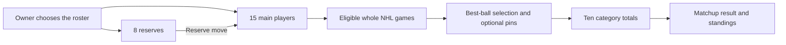

## 2. Rosters, ownership, and eligibility

### Main roster and reserves

The main roster determines who can earn scoring performances. The reserve roster
holds owned depth. A reserve still has a contract, carries salary, can be traded,
and earns roster days toward signing eligibility. Reserve games do not score
unless the player was promoted before that game's lock.

| State                            | Owned?                            | Can earn new scoring games?             | Contract salary counts?            | Uses a 23-player slot?                       |
| -------------------------------- | --------------------------------- | --------------------------------------- | ---------------------------------- | -------------------------------------------- |
| Main roster                      | Yes                               | Yes                                     | Yes, if contracted                 | Yes                                          |
| Reserve                          | Yes                               | No                                      | Yes, if contracted                 | Yes                                          |
| Injured on either tier           | Yes                               | Only an eligible main-roster appearance | Yes                                | Yes                                          |
| Unsigned offseason signing right | Rights only                       | Not through the current roster          | No new contract charge             | No                                           |
| Pending incoming offer           | Not yet                           | No                                      | Full obligation reserved           | Capacity reserved, net of its distinct drop  |
| Frozen tournament player         | Historical tournament entitlement | NHL playoff games count                 | Current cap accounting is separate | Does not create a second current roster slot |

An owner is a person, a franchise is the enduring league identity, and a team is
that franchise's instance in a particular season. Contract history and competitive
records must survive an owner change or season rollover.

Positions are published before the draft and locked when the season begins.
There are no midseason eligibility changes, including corrections. A newly added
player receives an initial assignment; subsequent changes wait until offseason.
A C/LW can fill either position, but one player or game never fills both at once.

Vacancies are legal. They provide neither extra move allowances nor extra scoring
capacity. A team cannot exceed 15 main players, eight reserves, or 23 total, and
its main roster must fit the position limits. Offseason acquisitions must leave
enough capacity to construct a legal final roster.

**Example:** A team has three centers and three left wings. One center also
qualifies at LW. The app may rearrange those players when a trade arrives; the
owner need not perform cosmetic position swaps. Moving a player between main and
reserve is a real roster move and follows the move budget.

## 3. Best-ball scoring

### Categories and whole games

| Skaters: higher is better                                      | Goalies               | Direction |
| -------------------------------------------------------------- | --------------------- | --------- |
| Goals, assists, points, power-play points, shots, hits, blocks | Wins                  | Higher    |
| —                                                              | Goals against average | Lower     |
| —                                                              | Save percentage       | Higher    |

An eligible player-game is indivisible. Selecting a game includes every category
from that appearance. The app cannot take its goals but discard its shots, or
combine pieces of different games into one appearance.

Game ratings select performances; they do not replace category competition with
fantasy points. The final category tally determines the winner. Equal category
win totals are decided by home ice.

### Appearance limits

`N` means calendar dates on which at least one NHL game is actually played within
the matchup, not its number of calendar days or weeks.

| NHL game days | All skaters | C ceiling | LW ceiling | RW ceiling | D ceiling | Goalie minimum |
| ------------: | ----------: | --------: | ---------: | ---------: | --------: | -------------: |
|             6 |          39 |        12 |         10 |         10 |        15 |              3 |
|             7 |          45 |        14 |         12 |         12 |        18 |              3 |
|            10 |          65 |        20 |         17 |         17 |        26 |              3 |
|            14 |          91 |        28 |         24 |         24 |        36 |              3 |

```text
All skaters = floor(6.5 × N)
C           = 2 × N
LW and RW   = round(12 × N / 7), each
D           = round(18 × N / 7)
```

The positional ceilings are not guaranteed allocations. Their sum can exceed
the overall ceiling. A seven-day team cannot count 56 skater games merely because
14 + 12 + 12 + 18 equals 56.

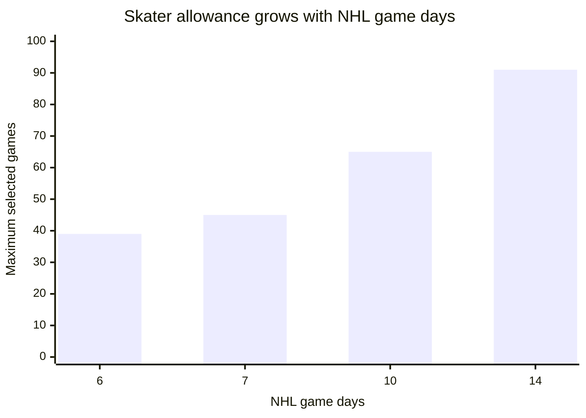

A postponed game belongs to the matchup in which it is actually played. If every
game on a date is postponed, that date no longer adds capacity. The app recalculates
the limits and repairs conflicting pins. Move allowances remain two and four.

### Selection order

The existing RankingEngine day-performance profile supplies F/D/G game ratings.
Every franchise uses the same completed NHL comparison pool for the matchup.
An unowned player's game can inform that common rating pool without being eligible
to score for any GSHL team. The season's engine version and impact calibration
are fixed; provisional scores update as the matchup's game pool grows.

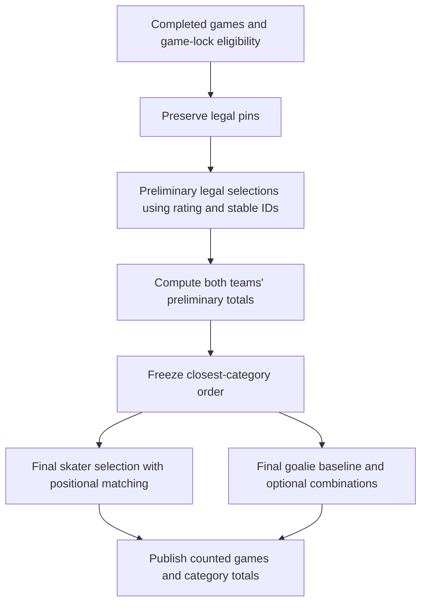

Higher-rated games win selection priority. Equal ratings compare categories from
closest to least close, then canonical player-game ID. The category order is
computed once for both opponents, not repeatedly from each new selection.

"Closest" is the absolute category gap divided by the historical impact of an
ordinary appearance in that category. These are comparison units, not added
category weights. The calibrated 2024–25 reference covers 47,224 skater and 2,764
goalie appearances. Full constants and provenance are in the
[calibration artifact](gshl-relaunch-calibration.json).

**Example:** A one-goal gap is about 5.98 typical impacts. A one-assist gap is about
3.55. Assists therefore break an equal-rating tie before goals. A 50.01-rated game
still beats a 50.00-rated game unless the latter is pinned.

**Multi-position example:** With one remaining C and one remaining LW appearance,
a 90-rated C/LW and an 80-rated C can both fit: assign the first at LW. Assigning
the flexible player to C permanently would incorrectly block the other game.

### Owner pins

Owners can pin whole games in the games table. Unpinned capacity stays automatic.
A lower-rated pin may be strategically useful when its specific production helps
the category matchup. Pins cost neither an acquisition nor a reserve move.

| Situation                                           | Result                                                         |
| --------------------------------------------------- | -------------------------------------------------------------- |
| Better unpinned game arrives                        | Replaces a weaker unpinned game if legal                       |
| Better game arrives but all usable slots are pinned | Pins remain                                                    |
| Owner pins a lower-rated game                       | It stays selected while legal                                  |
| Postponements reduce capacity below pinned usage    | Lowest-rated conflicting pins are removed, with an explanation |
| Owner resets to automatic                           | The app selects all eligible games normally                    |
| Monday finalization has passed                      | Selection is locked                                            |

Pins last only for the matchup. They can be edited until finalization even if
the player's transactions are currently locked.

### Goalies

Goalie selection is separate from skater selection. Starts and relief appearances
both count toward the three-appearance minimum; there is no minimum-starts rule.

1. Preserve pins, then fill the baseline to three appearances by goalie rating.
2. With fewer than three available, use all available games and apply forfeiture.
3. Evaluate combinations of remaining games. An automatic addition cannot worsen
   either GAA or save percentage and must improve a ratio or add wins.
4. Compare qualifying combinations in the fixed goalie category order. Exact
   ties prefer fewer optional games, then stable IDs.

Owners may pin additional games that trade a worse ratio for a win. Those pins
become part of the baseline against which automatic additions are assessed.
There is no fixed maximum number of goalie appearances.

| Appearance set        | Wins |  GA | Shots faced | Saves | Minutes |  GAA |    SV% |
| --------------------- | ---: | --: | ----------: | ----: | ------: | ---: | -----: |
| Three-game baseline   |    0 |   9 |          90 |    81 |     180 | 3.00 | .90000 |
| Extra game A alone    |    0 |   2 |          10 |     8 |      60 | 2.00 | .80000 |
| Extra game B alone    |    0 |   4 |          60 |    56 |      60 | 4.00 | .93333 |
| Baseline plus A and B |    0 |  15 |         160 |   145 |     300 | 3.00 | .90625 |

A alone harms save percentage. B alone harms GAA. Together they preserve GAA and
improve save percentage, so the pair qualifies. This is why arrival-order selection
would be wrong.

Ratios use combined underlying totals: `GAA = 3600 × GA / seconds` and
`SV% = saves / shots faced`. A zero denominator remains undefined rather than
becoming a perfect result. Missing statistics are a data problem, not zero production.

| Goalie qualification               | Matchup treatment                                         |
| ---------------------------------- | --------------------------------------------------------- |
| Both teams reach three appearances | Compare all three goalie categories                       |
| Only one team reaches three        | Other team forfeits all three goalie categories           |
| Neither reaches three              | Exclude all three goalie categories; compare skaters only |

Counted performances feed GSHL category totals and production awards. The NHL
talent model continues using NHL performance independently of GSHL game selection.

## 4. The weekly clock

All owner-facing times are Eastern, including daylight-saving changes. The app
must distinguish the management period, player lock, claim cutoff, and scoring
finalization; they are not the same deadline.

Each team gets two external acquisitions and four reserve moves per matchup.
Unused allowances expire rather than carrying forward.
These are in-season matchup budgets. Offseason UFA and draft acquisitions are
governed by cap and roster capacity rather than a two-signing limit; offseason
main/reserve moves are unlimited.

| Management action                                     | Allowance consumed                                     |
| ----------------------------------------------------- | ------------------------------------------------------ |
| One main/reserve swap, exchanging one player each way | One reserve move                                       |
| Demote an injured player, then promote them later     | Two reserve moves in total                             |
| Automatic rearrangement among eligible main positions | None                                                   |
| Pin or unpin an eligible performance                  | None                                                   |
| Successful external claim                             | One acquisition in its execution period                |
| Trade acquisition                                     | No acquisition charge; required tier moves still count |

Accepted trades, awarded acquisitions, and tier moves execute immediately when
every involved player is unlocked. If anyone is locked, the complete transaction
waits for an eligible noon run after unlock. Ordinary unlocked tier moves do not
wait for noon. Both swapped players and any required drop count as involved.

| Event                              | Time                                    | Meaning                                                                     |
| ---------------------------------- | --------------------------------------- | --------------------------------------------------------------------------- |
| Player locks                       | Actual NHL game start                   | Ownership/tier for that game is fixed; involved transactions wait           |
| Player unlocks                     | 5 a.m. Eastern                          | Finishing the NHL game does not itself unlock the player                    |
| New management period              | Monday 5 a.m. at the start of a matchup | New acquisition/reserve allowances begin                                    |
| Daily claims and transaction queue | Noon Eastern                            | Close eligible claims and execute eligible queued transactions              |
| Prior matchup finalization         | Monday noon after matchup end           | Stop pins/corrections; finalize results, eliminations, and weekly processes |

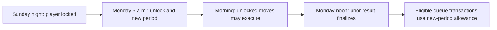

A longer matchup has one management allowance for its entire duration; intervening
Mondays do not reset it. Prior-week scoring may still be editable Monday morning
while roster transactions already use the new matchup's allowance.

**Example:** A Sunday claim award requires dropping a player whose game has started.
The acquisition waits as a complete unit. At Monday noon it executes using a
Monday-period acquisition, provided no involved player has re-locked and capacity
is available. The dropped player's Sunday performance remains with the original
team and original tier.

Final statistics must be ingested before finalization. Corrections received after
Monday noon do not reopen a completed GSHL matchup. A Sunday-night apparent loss
does not eliminate a team until its matchup becomes final.

## 5. Transactions and binding commitments

An action can be submitted, accepted or awarded, and executed at different times.
Acceptance creates a commitment; execution changes ownership and consumes the
applicable move allowance.

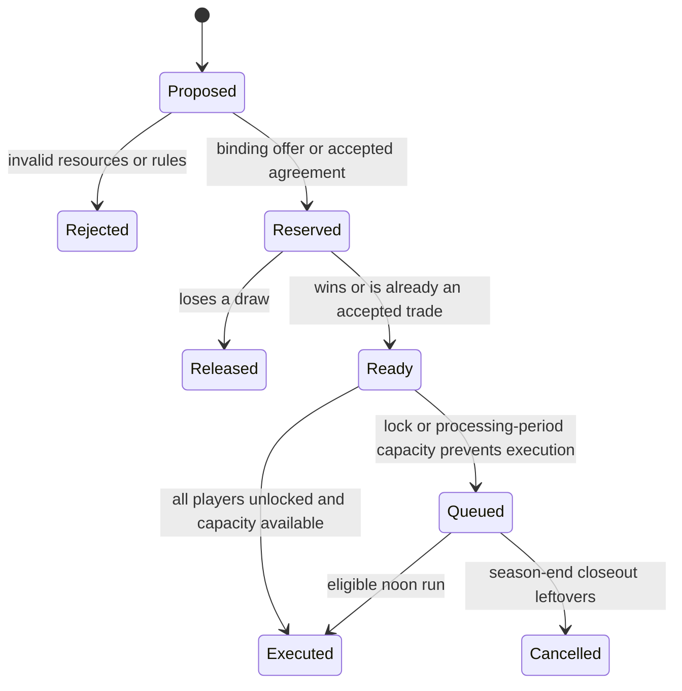

The first offer is a commitment when the second offer is made. Every later action
must fit assuming every previous agreement wins, regardless of odds. Every possible
mixture of wins and losses must also remain legal. Later actions cannot reuse a
reserved player, pick, conditional drop, roster slot, or cap dollar.

| Resource       | What must be reserved                                                   |
| -------------- | ----------------------------------------------------------------------- |
| Salary         | Full obligations in every covered season, including conditional buyouts |
| Roster         | Capacity for every incoming player, after distinct conditional drops    |
| Positions      | A legal arrangement under every relevant outcome                        |
| Player or pick | Exclusive commitment so it cannot be promised elsewhere                 |
| Acquisition    | Expected execution-period allowance, carried forward if delayed         |
| Reserve move   | Any required main/reserve change caused by execution                    |

**The conditional-buyout trap, in millions:**

| Outcome      | Other salary | Old player | New A | Buyout | New B |   Total |
| ------------ | -----------: | ---------: | ----: | -----: | ----: | ------: |
| Neither wins |           80 |         10 |     0 |      0 |     0 |      90 |
| A wins       |           80 |          0 |     1 |      5 |     0 |      86 |
| B wins       |           80 |         10 |     0 |      0 |    13 | **103** |
| Both win     |           80 |          0 |     1 |      5 |    13 |      99 |

B is rejected under a $100M cap even though both wins fit. It depends on savings
from A's buyout, which is not guaranteed to happen.

If unexpected delay moves a commitment into a period with insufficient allowance,
it waits until capacity is available; it does not exceed the limit or disappear.
Season-end closeout is the explicit exception that cancels remaining transactions.
The app records actual execution order and does not favor one transaction type.

## 6. Claims and the waiver wire

All available in-season unowned players use daily claims. There are no immediate
first-click free-agent acquisitions. A dropped player spends at least 48 hours
on waivers and then resolves at the first eligible noon closing run.

Claims received before noon join that day's run; those received at or after noon
join the following day. Known locks can defer execution after the award.

Each pending claim consumes one of the team's two available acquisition
reservations and names a distinct drop or a vacancy. There are no ranked backup
claims. Two available acquisitions cannot support three binding claims.

### Claim score

Use frozen player-rating percentiles from zero to one. Let `V` be the greatest
sum that fits a legal 15-player main roster, choosing from all owned players,
including reserves. Vacant slots have value zero.

```text
Quality     = V(before) / 15
Weakness    = 1 - Quality
Opportunity = max(0, V(after target and drop) - V(before))
Claim score = 75% × Opportunity + 25% × Weakness
```

Adding one player valued at most one cannot increase the roster sum by more than
one. Moving existing players to reserve does not hide them from the calculation.
Dropping a useful player at another position can erase the apparent upgrade.
Salary, term, Ladder, and draft capital do not influence claim scores.

The probability calculation is shared with UFA. A sole valid claimant wins
automatically. Final inputs freeze at closing; displayed odds before then are
provisional. Groups with the same closing time share one pre-processing snapshot.

**Example:** A 0.90 player improves a rebuilding roster by 0.60 and a strong roster
by 0.10. With quality 0.30 and 0.80 respectively, the scores are 0.625 and 0.125:
the rebuilding team has a **78.58%** chance, the stronger team **21.42%**.

## 7. Trades

Trades are negotiated socially and submitted formally in the app. The offer shows
players, picks, contracts, retention, cap effects, and necessary roster changes.
There is no routine league vote or Commissioner approval.

Acceptance is binding and reserves both sides' resources. An unlocked trade
executes immediately; otherwise the entire exchange waits for an eligible noon
run. Both sides must succeed together. Picks-only trades can execute immediately
while trading is open.

| Trade effect                                               | Move cost                                |
| ---------------------------------------------------------- | ---------------------------------------- |
| Incoming player directly replaces a departing main player  | No acquisition or reserve move           |
| Incoming player fills an available legal main/reserve spot | No acquisition; no unnecessary tier move |
| Existing main player must be demoted to make room          | One reserve move                         |
| Additional independent main/reserve reshuffling            | Normal reserve-move rules                |

Only picks in the upcoming draft can be traded. The inherited trade deadline is
2.5 weeks before the end of the GSHL regular season, with the exact timestamp
published beforehand. Trading reopens after the NHL playoff tournament ends.
Rights trades and sign-and-trade arrangements before June 30 are ordinary
immediate transactions when trading is open.

Trade-block listings identify at least one desired type of return. Owners should
acknowledge direct inquiries within 72 hours. App suggestions can identify needs
and possible partners but do not certify that a trade is fair.

## 8. The season, playoffs, and placement

The existing competitive structure continues. The regular season generally spans
21–23 matchup periods, leaving three NHL regular-season weeks for GSHL playoffs.
Each team plays its six conference opponents twice, once home and once away;
remaining games are interconference, with opponents and home ice rotating where
practical.

| Result                                 | Standings points |
| -------------------------------------- | ---------------: |
| Clear category win                     |                3 |
| Home-ice win after tied category tally |                2 |
| Away loss after tied category tally    |                1 |
| Clear category loss                    |                0 |

Teams rank by win/loss record first. Equal records are separated by total
standings points, head-to-head points, head-to-head category differential, overall
category differential, conference points, conference category differential, then
Owner Ladder. Home-ice wins count as wins.

Eight teams qualify: each conference's top three plus the two best remaining
teams league-wide. Normally each conference runs 1-v-4 and 2-v-3. If qualification
produces five teams in one conference and three in the other, the lower wildcard
crosses over to form two four-team brackets. Conference winners meet for the Cup.
Higher seeds receive home ice; the stronger regular-season standing decides Cup
Final home ice.

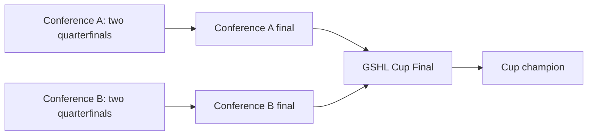

The placement competition becomes the **Draft Placement Tournament**. The
inherited bracket determines the next draft's order; the relaunch's elimination,
reserve-move, and scoring rules govern management rather than the old Yahoo
full-roster-lock language.

| Draft slots | How placement is determined                                                                            |
| ----------- | ------------------------------------------------------------------------------------------------------ |
| 1–6         | Non-playoff bracket across three weeks; details below                                                  |
| 7–10        | Quarterfinal losers play within conferences in week two, then winners play for 7/8 and losers for 9/10 |
| 11–12       | Conference-final losers play; winner gets 11                                                           |
| 13          | Cup runner-up                                                                                          |
| 14          | Cup champion                                                                                           |

For slots 1–6, week one is 9-v-10, 11-v-12, and 13-v-14. The losers of 9-v-10
and 11-v-12 play a two-week matchup for 5/6. In week two, the 13-v-14 winner plays
the 11-v-12 winner; the 13-v-14 loser plays the 9-v-10 winner. Those semifinal
winners play for 1/2 and the losers for 3/4 in week three. Winners take the earlier
pick. The Brophy Award and its negative Ladder value move to last place in the
regular season.

Once a team officially misses the playoffs or loses a Cup matchup, it cannot
submit new external add/drop claims. Previously binding claims survive. It can
continue main/reserve moves within the usual four-move allowance for its period.

## 9. Season-end closeout and the NHL tournament

The final Monday-noon closeout has a strict order:

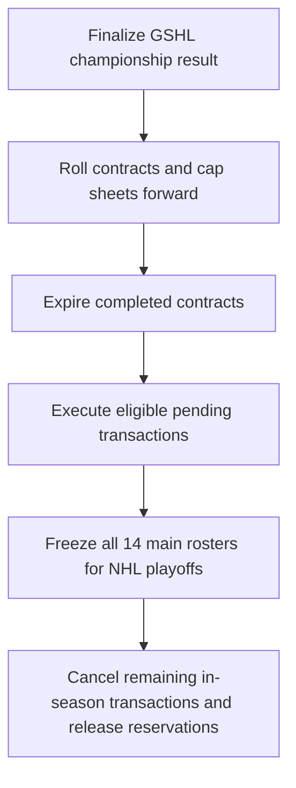

A drop after contract expiry creates no buyout. A transaction executed before
the freeze can place its acquired player into the tournament roster. A cancelled
transaction has no roster effect. Earned GSHL results do not change.

The tournament is a separate frozen competition, not another best-ball matchup.
Every NHL playoff statistic from each frozen main roster counts. Reserves are
excluded; there are no tournament moves or appearance ceilings. NHL team
advancement intentionally creates additional scoring opportunity.

| Rule                 | Tournament treatment                                                          |
| -------------------- | ----------------------------------------------------------------------------- |
| Participants         | All 14 franchises                                                             |
| Categories           | Same ten categories                                                           |
| Category scoring     | First gets 14 points down to one for last                                     |
| Category ties        | Split points for occupied positions                                           |
| Goalie qualification | Four appearances for GAA and SV%; below minimum gets zero in those categories |
| Goalie wins          | Count even below the four-appearance ratio minimum                            |
| Overall tie          | Most outright category wins, then second places, then thirds, and so on       |
| Unbroken tie         | Share title and $50; each winner gets five Ladder points                      |
| Other effects        | Does not change GSHL standings, power, playoffs, or draft order               |

**Example:** Two teams tied for second in hits share second- and third-place
points: `(13 + 12) / 2 = 12.5` each. A team with three goalie appearances gets
zero GAA and SV% points even if its ratios would otherwise be excellent.

After GSHL closeout, offseason tier moves are unlimited, but they alter only the
current roster. They cannot rewrite the frozen tournament lineup. Trading remains
closed until the tournament ends.

## 10. Contracts and cap accounting

### Signing rights and eligibility

The re-signing window runs during the NHL playoffs and closes at the end of June
30 Eastern. Salaries are published when the GSHL season ends and fixed for that
offseason. A re-signing executes immediately and cannot be revised or withdrawn.

To qualify for incumbent re-signing, a player must have spent **more than two-thirds**
of the GSHL regular season on the signing team's roster or on league rosters in
total. Reserve days count. Exactly two-thirds is insufficient. Measure player-days
without double-counting a day merely because a player changes franchises.

Unsigned signing rights can exceed 23 because they are not signed roster places.
All unsigned rights lapse June 30. On July 1, only signed players remain on current
rosters; unsigned players enter the shared UFA/draft pool regardless of incumbent
signing eligibility, except for the protected 2027 class.

### Contract lifecycle

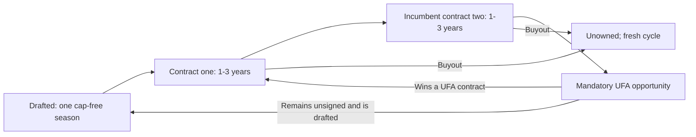

| Event                     | Salary or status                                             |
| ------------------------- | ------------------------------------------------------------ |
| First incumbent contract  | 100% of published base salary                                |
| Second incumbent contract | 110% of updated base salary                                  |
| UFA signing               | Accepted offer; contract one of a fresh two-contract cycle   |
| Second-contract expiry    | Mandatory market opportunity; no incumbent matching right    |
| Trade                     | Existing salary, remaining term, and cycle follow the player |
| Buyout                    | Breaks the cycle; roster-day history remains                 |

A former owner can bid in mandatory UFA but receives no incumbent preference.
A genuinely available unsigned player can return through the draft cap-free.

Contracts start immediately when signed and expire at the GSHL finals closeout
of their final covered season. A three-year signing after the 2028 finals covers
seasons ending in 2029, 2030, and 2031. Each season has a separate cap sheet.
Expired contracts do not double-charge their replacements.

### Base salary curve and rounding

The new curve is a monotone cubic interpolation from rank 3 through the published
anchors, with ranks 1–3 fixed at $10M and rank 400 onward at $1M. Its application
begins with the 2028 transition, not the 2027 market.

| Salary-model rank | Base salary |
| ----------------: | ----------: |
|               1–3 |     $10.00M |
|                20 |      $9.25M |
|               160 |      $5.75M |
|               325 |      $2.50M |
|     400 and later |      $1.00M |

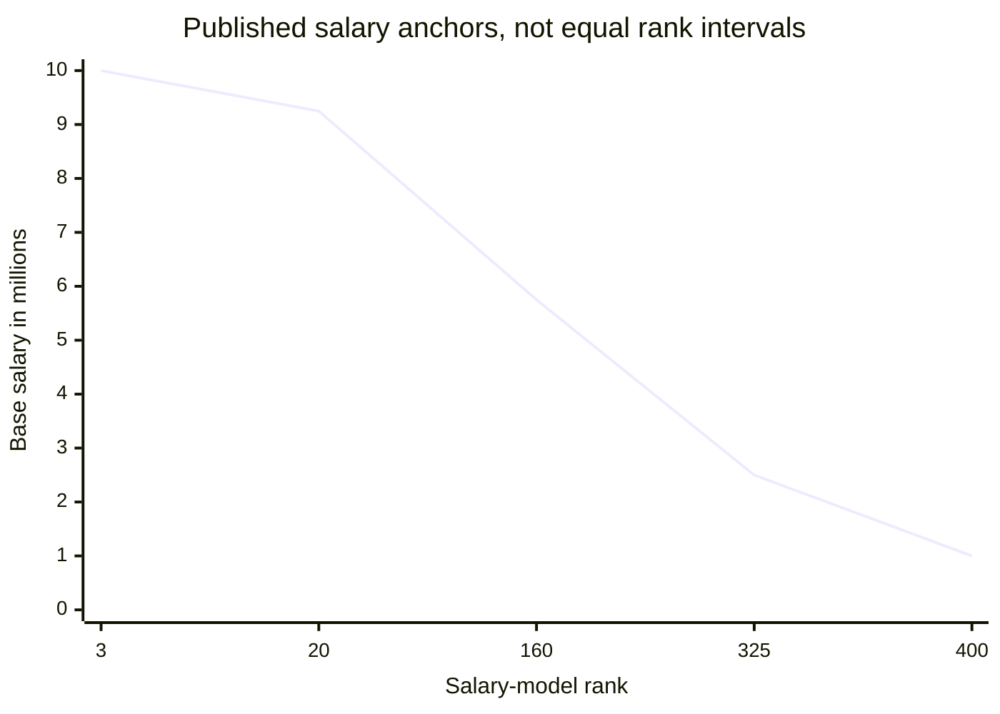

The chart connects anchors for explanation; the actual calculation uses the
curve in the [salary runtime](../../scripts/src/runtime/relaunch-salary-curve.ts).
Base, renewal, and new UFA salaries round to the nearest $50,000, with halves
rounded upward. Calculate premiums from the rounded base, then round the final
salary. Do not compound bid steps from a rounded prior bid. Existing contracts
retain their signed salary.

Retention and buyouts are allocations of an existing salary, so they use exact
percentages rather than being rounded as new salaries.

### What consumes cap

```text
Committed cap = current contract shares
              + outgoing retained salary
              + buyout charges
              + incremental worst-case pending obligations
```

Contracted reserves cost the same as contracted main players. Newly drafted
players are cap-free in their initial season. A signing must fit every covered
season, not just the immediate offseason.

The top-210 salary benchmark averages $105.825M per 15-player team, $116.45M at
renewal prices, and approximately $157.16M at maximum normal UFA prices. These
are rank-pool illustrations, not actual team forecasts. The $100M cap intentionally
forces tradeoffs. Roughly 15 contracts is a target, not a quota or keeper maximum.

### Retention and buyouts

| Policy                             | Rule                                                                     |
| ---------------------------------- | ------------------------------------------------------------------------ |
| Retention amount                   | 10%–50%, in 10% steps                                                    |
| Retention duration                 | Remaining original term                                                  |
| Retention capacity                 | Two outgoing obligations per franchise                                   |
| Repeat retention                   | Each contract can be retained only once                                  |
| Retaining franchise reacquisition  | Prohibited until retention expires                                       |
| Buyout amount                      | 50% of the dropping franchise's salary share                             |
| Buyout duration                    | Through the later of original expiry or end of the following GSHL season |
| Buying-out franchise reacquisition | Prohibited through original contract expiry                              |
| Offseason release availability     | Wait 48 hours, then UFA/draft if their windows permit                    |

**Retained-contract example:** A $5M contract has 40% retained. The original seller
pays $2M and the current team pays $3M. If the current team buys out the player,
its charge becomes $1.5M for the buyout duration; the seller continues its $2M
through original expiry. The seller's retention slot clears at original expiry,
even if the buyer's buyout runs longer.

## 11. UFA bidding and selection

UFA opens July 1 after re-signing closes. The first valid offer starts a single
seven-day market for that player. Later bids do not extend the deadline. Salary,
term, deadline, and offers are public; odds remain provisional until closing.

### Price ladder

Normal UFA uses `base × 1.10 × (1 + 0.05k)` for `k = 0…7`, rounding each final
annual salary to $50,000. This is 110%–148.5% of base before rounding. Terms are
one, two, or three years. A bid revision cannot reduce salary or term.

| Bid step | Nominal percentage of base | $4M base: rounded annual offer |
| -------: | -------------------------: | -----------------------------: |
|        0 |                     110.0% |                         $4.40M |
|        1 |                     115.5% |                         $4.60M |
|        2 |                     121.0% |                         $4.85M |
|        3 |                     126.5% |                         $5.05M |
|        4 |                     132.0% |                         $5.30M |
|        5 |                     137.5% |                         $5.50M |
|        6 |                     143.0% |                         $5.70M |
|        7 |                     148.5% |                         $5.95M |

Each offer reserves full cap and capacity for its term. A distinct conditional
drop may be attached. The player remains owned until a win; a loss keeps that
player and releases the reservation. A win executes the signing and drop
together, including any buyout.

### Offer score and draw

| Factor                    | Weight | Normalization                                                     |
| ------------------------- | -----: | ----------------------------------------------------------------- |
| Salary                    |    45% | `(offer - rounded minimum) / (rounded maximum - rounded minimum)` |
| Term                      |    25% | One year = 0; two = .5; three = 1                                 |
| Roster fit                |    20% | Player-specific blend of quality and opportunity                  |
| Previous team performance |     5% | League percentile of prior-season performance                     |
| Owner Ladder              |     3% | Percentile of official Ladder snapshot                            |
| Draft capital             |     2% | Percentile of remaining usable upcoming picks                     |

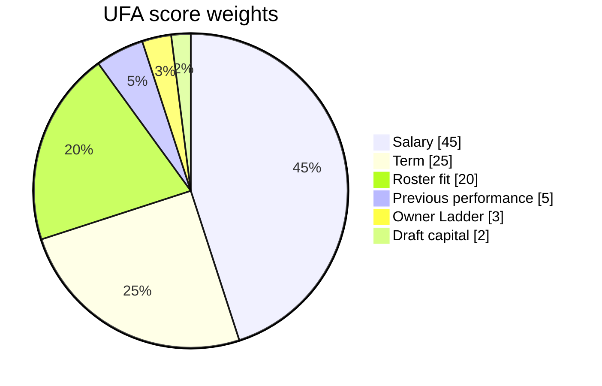

Roster quality and opportunity use the same best-legal-roster calculation as
claims. If `p` is the player's F/D/G peer percentile:

```text
fit = (0.35 + 0.30p) × quality + (0.65 - 0.30p) × opportunity
```

Elite players emphasize teammate quality more; lower-rated players emphasize
opportunity more. All owned players count. Pending offers reserve resources but
do not become owned players for odds. Exact rating snapshots and secondary-factor
formulas are in the [numerical specification](gshl-relaunch-acceptance.md).

Both UFA and claims use:

```text
weight(i) = exp(3 × score(i))
P(i)      = 0.10 / number of bidders
          + 0.90 × weight(i) / sum of all weights
```

Ten percent of the entire probability pool is divided equally. Equal scores have
equal chances; a sole bidder wins automatically. Strong offers matter without
guaranteeing victory.

| Two-bidder example                                                     |    Favored team's chance |
| ---------------------------------------------------------------------- | -----------------------: |
| Otherwise equal; maximum salary/three years versus minimum/one year    |                   85.18% |
| Elite target, equal money/term; strong roster versus rebuilding roster |     51.62% strong roster |
| Rebuilder offers maximum/three years; strong team minimum/one year     | 84.53% rebuilding roster |

The award stores inputs, probabilities, and the draw result. A retry cannot reroll
a lost market. Winning is binding; losing immediately releases reserved capacity.

### Shared UFA/draft availability

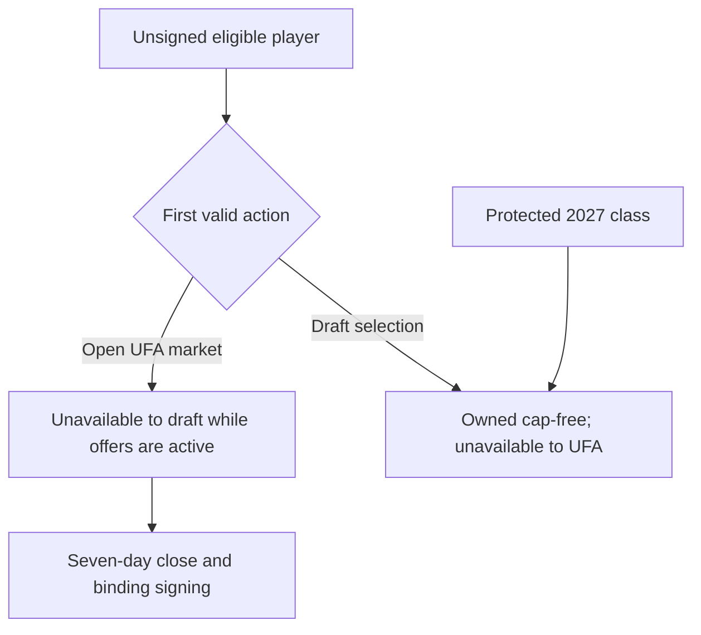

Opening an offer to deny draft access is permitted, but the offer remains binding.
If nobody else bids, its owner must sign the player. The app must atomically
prevent two owners from acquiring the same player through simultaneous routes.

New markets stop opening seven days before the published season-opening instant;
existing markets finish by that instant. Remaining unowned players then enter
ordinary daily claims. The draft's end does not create an offseason instant-pickup
window. Losing a late market does not guarantee time for another seven-day attempt.

## 12. The slow draft

The draft begins August 1 and overlaps UFA. There are up to 23 regular rounds.
Keepers consume the latest available original picks first. Acquired picks are
preserved where capacity permits. Teams with no usable selections but legal
vacancies receive end-of-draft fill picks.

| Clock rule                        | Behavior                                                       |
| --------------------------------- | -------------------------------------------------------------- |
| Active hours                      | 10 a.m.–10 p.m. Eastern every day                              |
| Time per pick                     | Four active hours                                              |
| Overnight                         | Both picking and the clock pause                               |
| Early selection                   | Immediately passes the turn                                    |
| Timeout                           | Owner queue, then highest-rated legal fallback                 |
| Current pick traded               | Buyer inherits remaining time                                  |
| Pending UFA fills available space | Temporarily skip; preserve usable pick                         |
| Lost UFA restores space           | Finish live pick, then restore skipped picks in original order |
| Restored pick                     | Receives the normal four-active-hour clock                     |
| After final fill cutoff           | Draft stays closed; legal vacancy waits for ordinary waivers   |

**Clock example:** A pick begins at 8 p.m. Two hours run before the 10 p.m. pause.
Its remaining two hours run from 10 a.m. until noon the next day. Trading it at
11 a.m. gives the buyer one hour, not four.

**Capacity example:** A team owns 21 players and has two live UFA offers without
drops. Both remaining spaces are reserved, so it cannot draft a 22nd player yet.
If one offer loses, a usable skipped pick returns after the current live pick.
If the loss happens after the final fill cutoff, the team carries the vacancy.

| Draft workload                   | Full-clock active hours | Active draft dates at 12 hours/day |
| -------------------------------- | ----------------------: | ---------------------------------: |
| Expected eight rounds, 112 picks |                     448 |                                 38 |
| Maximum 23 rounds, 322 picks     |                   1,288 |                                108 |

Two weeks requires picks to average roughly 1.5 active hours. It is an expectation,
not a guarantee. Actual usable picks and restored selections must be checked
against the published calendar before launch.

## 13. The 2027–2028 transition

Here, a year names the season ending in that year and its following offseason.
The roster/scoring relaunch and the salary transition are related but distinct.

| Stage                    | Salary curve |                      Cap | UFA pricing                                     |
| ------------------------ | ------------ | -----------------------: | ----------------------------------------------- |
| 2027 re-signing          | Current      |                   $32.5M | Not yet open                                    |
| 2027 UFA and Super Draft | Current      |                   $32.5M | Normal 110%–148.5% range; new score/draw system |
| 2028 re-signing          | New          | **$60M firm checkpoint** | Not yet open                                    |
| 2028 UFA                 | New          |                    $100M | One-time 100%–150% of base                      |
| Later offseasons         | New          |                    $100M | Normal 110%–148.5% range                        |

The protected 2027 Seven-Year Super Draft class was verified against the app's
draft-class UI on October 16, 2026. Those players remain draft-only, existing
pick ownership and placement results stand, and the commitment survives any delay
in the full app relaunch. The verified named class must be published before
offseason decisions. Do not reconstruct it from an old approximate player count.

At the end of 2028 re-signing, existing contracts, new re-signings, retention,
and buyouts must fit the firm $60M checkpoint. There is no additional contract-count
limit. UFA then opens with $100M available cap. A team at exactly $60M has $40M
remaining before further obligations.

The special 2028 ladder is 100%, 105%, …, 150% of base, each rounded to $50,000.
A $4M base player receives offers from $4M to $6M. Existing contracts are not
repriced. Seven-day clocks, binding offers, terms, and scoring weights stay the
same. The new UFA system may launch independently before all relaunch features.

## 14. The annual operating calendar

| Milestone                 | What changes                                                                         | What stays binding                             |
| ------------------------- | ------------------------------------------------------------------------------------ | ---------------------------------------------- |
| GSHL regular season       | Best-ball, weekly moves, claims, open trading until deadline                         | Contracts and accepted commitments             |
| Trade deadline            | New trading stops                                                                    | Previously accepted lawful agreements          |
| Official elimination      | New external add/drop access ends                                                    | Earlier binding claims; reserve-move allowance |
| Final GSHL Monday noon    | Results finalize, contracts roll, eligible queue executes, tournament rosters freeze | Continuing contracts, retention, buyouts       |
| NHL playoff tournament    | Frozen-roster competition; re-signing window                                         | Frozen tournament entitlement                  |
| NHL tournament ends       | Trading reopens                                                                      | Signed contracts and existing obligations      |
| End of June 30            | Re-signing closes; unsigned rights lapse                                             | Existing and newly signed contracts            |
| July 1                    | UFA opens                                                                            | Full reservations for every offer              |
| August 1                  | Slow draft begins alongside UFA                                                      | UFA reservations and protected draft routes    |
| Final fill cutoff         | Draft completion ends                                                                | Live UFA offers continue to their deadlines    |
| Seven days before opening | No new UFA market openings                                                           | Existing markets finish                        |
| Season opening            | Ordinary claims reopen; positions lock                                               | Contracts, roster assignments, published rules |

Actual season-opening and fill-cutoff timestamps belong in the published league
calendar. They are operational dates, not unresolved league-policy questions.

## 15. The owner experience and league operations

### What the app must explain

| Screen                 | Owner needs to see                                                                                   |
| ---------------------- | ---------------------------------------------------------------------------------------------------- |
| Team roster            | Main/reserve players, legal positions, injuries, vacancies, salary, locks                            |
| Matchup games          | Counted, unselected, and pinned games; rating; assigned position; limits; reason a selection changed |
| Scoreboard             | Category totals, goalie qualification, home ice, provisional/final status                            |
| Claim/UFA confirmation | Binding terms, distinct drop, reservations, future-season cap, expected execution time               |
| Cap sheet              | Active shares, retained salary, buyouts, pending exposure, available room by season                  |
| Draft                  | Current owner, clock/pause, queue, usable/skipped picks, reserved roster capacity                    |
| Transaction history    | Submitted, awarded, queued, executed, lost/cancelled state and actual execution order                |

The NHL API takes precedence over ESPN when sources disagree. A source correction
cannot change locked season positions or reopen a finalized matchup. Missing or
stale data must be visible; a loading screen must not masquerade as a zero score.

The app prepares Monday Aftermath and Thursday Stakes posts for a human to review
and share on WhatsApp. Longer Press Box editions focus on major season events.
Push notifications emphasize decisions and deadlines. No competitive advantage
comes from chat volume. GM of the Year and Coach of the Year remain; detailed
award criteria are implementation work.

If the app is down, owners can submit through the designated timestamped WhatsApp
fallback before the ordinary deadline. The Commissioner enters valid requests
with their original times. No retrospective requests are accepted. Existing
rosters carry forward; the Commissioner handles exceptional delays pragmatically.

Owners must maintain legal rosters, acknowledge trade inquiries, make timely
offseason decisions, and respond to required corrections. If an owner ignores a
required cap or roster fix, the Commissioner fixes it at their discretion. Legal
vacancies, injuries, and quiet participation are not violations.

### Money and prizes

| Item                    | Amount |
| ----------------------- | -----: |
| Buy-in per owner        |    $50 |
| Total from 14 owners    |   $700 |
| GSHL Cup champion       |   $500 |
| Cup runner-up           |   $100 |
| NHL tournament champion |    $50 |
| League fees             |    $50 |

Advertised prizes are fixed. The Commissioner absorbs costs beyond the league-fee
allocation; those costs are not individually charged back to owners.

## 16. Readiness and acceptance

The intended full relaunch is the 2027 draft, subject to readiness. Documentation
and a passing offline model do not establish that the app implements these rules.

| Evidence                             | Current meaning                                                                    |
| ------------------------------------ | ---------------------------------------------------------------------------------- |
| Verified protected draft class       | Commissioner confirmed UI accuracy; preserve and publish it                        |
| Recalculated salary tables           | $50K rounding and rank-pool arithmetic checked                                     |
| Historical impact calibration        | NHL comparison units reconciled; not a full historical best-ball replay            |
| 13 offline acceptance tests          | Selection, odds, reservations, and logical closeout scenarios pass                 |
| 250 generated positional comparisons | Matching selection agrees with exhaustive small-case results                       |
| 200,000 simulated draws              | Observed frequency agrees with the specified probability formula                   |
| Production integration               | Still must demonstrate real concurrency, locks, calendars, ingestion, and closeout |

Launch requires a complete owner journey: ingest games, count legal performances,
submit and resolve commitments, draft, account for contracts, finalize a matchup,
and close a season. Historical replay must assess positional and goalie outcomes,
not simply confirm that the formulas execute. Representative real cap sheets
must show the intended difficult keeper choices.

After the first season, assess time spent maintaining lineups, trade participation
across owners, and whether owners find the league easier to maintain and more
worthwhile. More transactions alone do not establish success.
